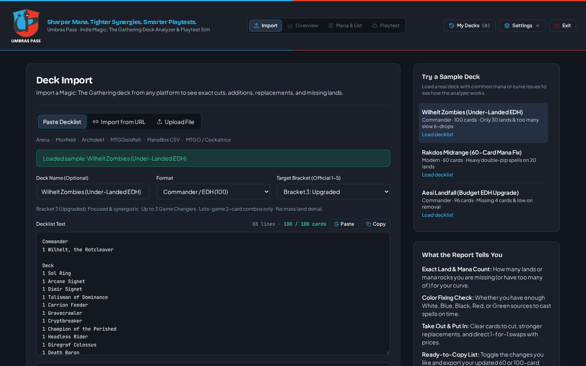
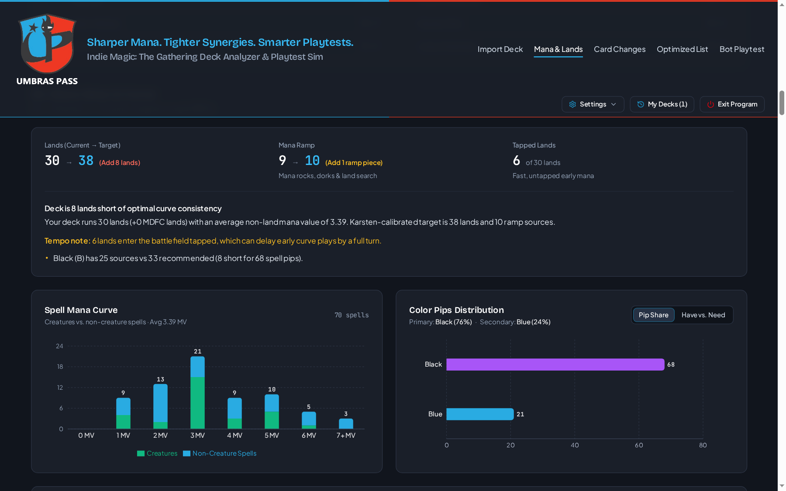
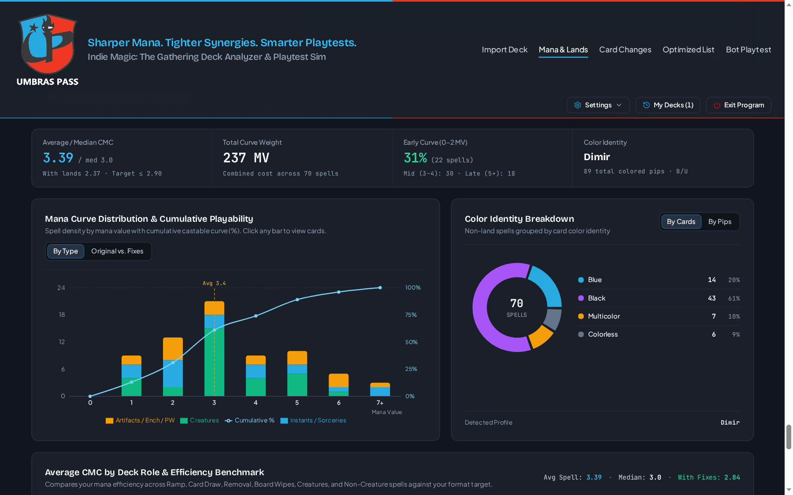
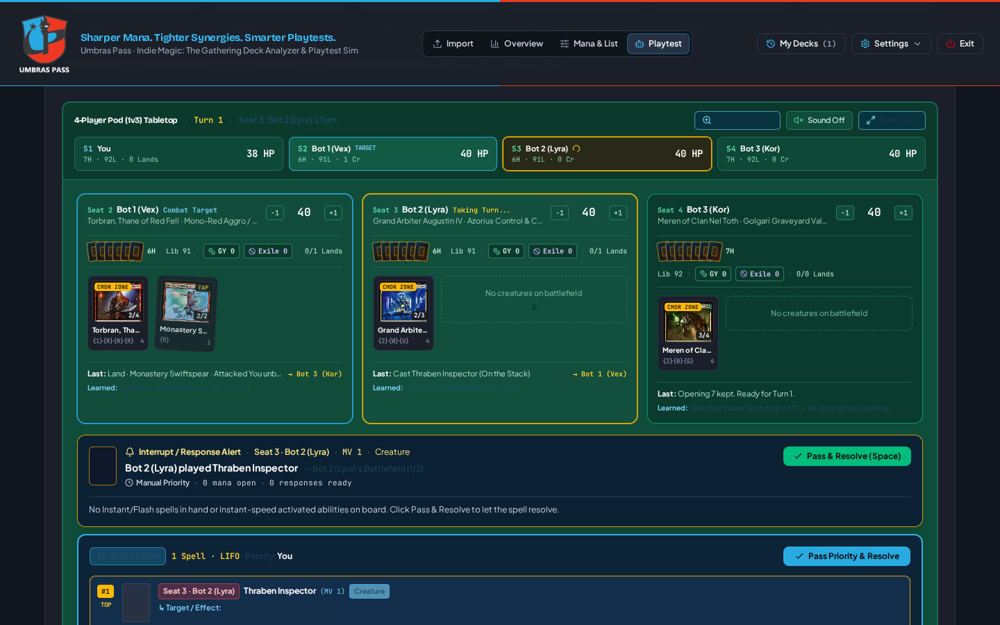
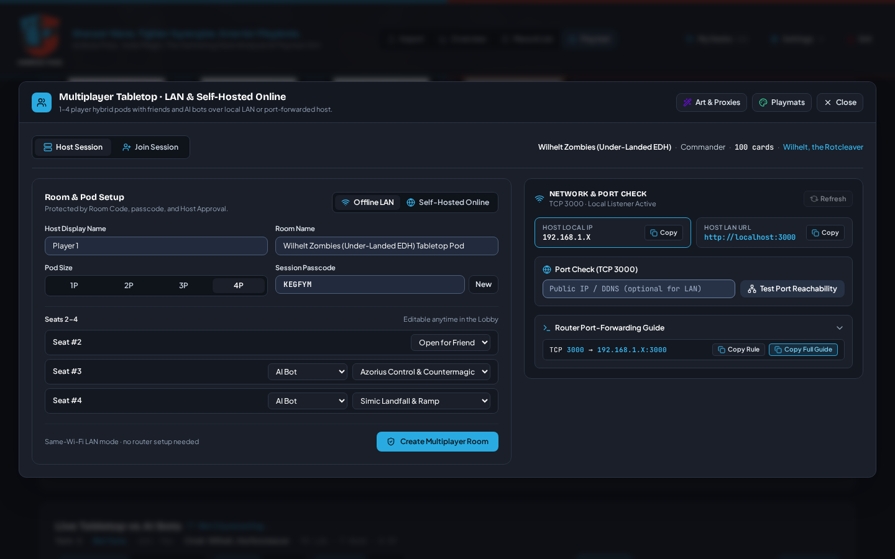
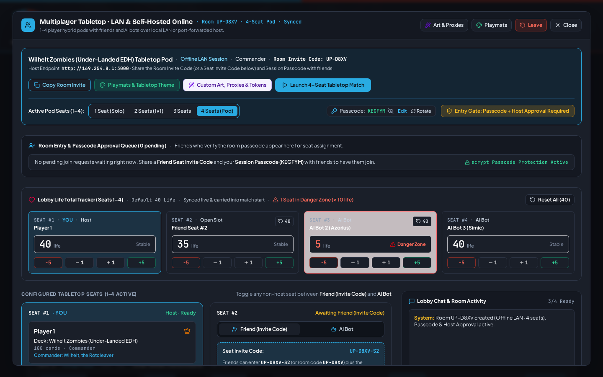
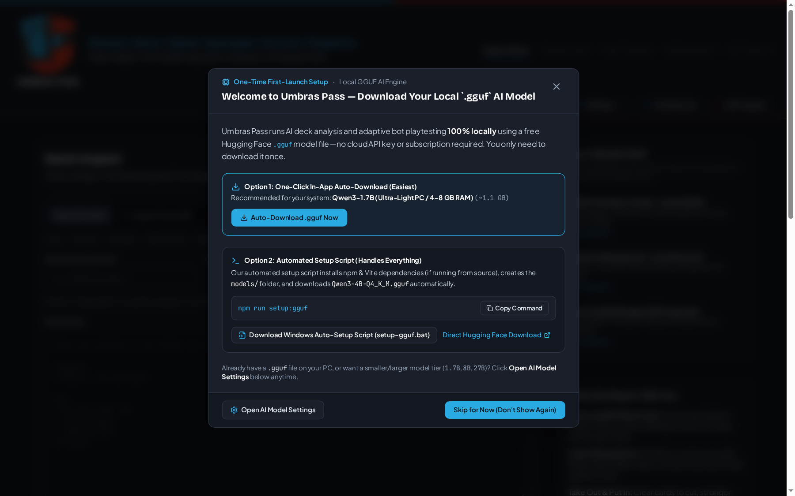

# Umbras Pass — Indie Magic: The Gathering Deck Analyzer & Playtest Sim

**Umbras Pass** is a free, standalone *Magic: The Gathering* deck analyzer, mana base optimizer, and interactive 1–4 player tabletop simulator. It features adaptive AI opponents powered by a local `.gguf` language model—meaning **100% private, offline AI with no cloud API keys or subscriptions required**—alongside **Offline LAN & Self-Hosted Online Multiplayer** with friends and AI bots.

> **Latest Release — v1.2.1 (Updated 2026-11-23):** Free-form drag-and-drop playmats, 1–4 player LAN & Self-Hosted Public IPv4 Multiplayer with strict localhost firewall protections, animated **d20** turn-order rolls, enlarged tabletop play areas, custom playmats & card proxies/tokens, and stability fixes. See **[CHANGELOG.md](CHANGELOG.md)**, **[RELEASE_NOTES_v1.2.1.md](RELEASE_NOTES_v1.2.1.md)**, and the **[Documentation Wiki](docs/wiki/Home.md)** · **[umbraspass.org](https://umbraspass.org/)**.

<!-- Quick Navigation -->
- [What's New & Latest Updates](#whats-new--latest-updates)
- [Key Features](#key-features)
- [Planned Future Updates & Features](#planned-future-updates--features)
- [Program Screenshots](#program-screenshots)
- [Getting Started](#getting-started)
  - [Option A: Windows App (No Coding Required)](#option-a-windows-app-no-coding-required)
  - [Option B: Run from Source (Developers)](#option-b-run-from-source-developers)
- [Manual AI Model Setup (Optional)](#manual-ai-model-setup-optional)
- [Troubleshooting & FAQ](#troubleshooting--faq)
- [Developer Reference & Building Releases](#developer-reference)
- [Disclaimer](#disclaimer)

---

## What's New & Latest Updates

- **Self-Hosted Public IPv4 Multiplayer & Localhost Firewall:** Automatically binds port `3000` on `0.0.0.0` for router port forwarding, adds on-demand **Host Public IPv4 Detection**, direct `UP-XXXX` room code / seat invite URLs, scrypt-hashed passcodes + **Host Lobby Approval**, hidden public/WAN room directories, sanitized remote errors, and strict **`localhost`-only firewall rules** protecting local decks, OS paths, diagnostics, and `.gguf` AI routes.
- **Animated d20 Turn-Order Roll-Off:** Interactive 20-sided die roll-off stage and launch modal across **Live Play vs AI Bots** and **Multiplayer Lobbies**, complete with automatic sudden-death tie-breakers, sound cues, and one-click table chat sharing.
- **Enlarged & Refined Tabletop Play Area GUI:** Upsized permanent and hand card tiles, taller art frames, fanned hidden-hand card backs, live 2/3/4-seat turn-order strips, expanded free-form playmats, and full vertical MTG card tiles inside Online, LAN, Live Bot, Solo Goldfish, and Match Replay sessions.
- **Streamlined Playtest Arena & Program-Wide UI Polish:** Cleaner navigation, larger touch targets (`min-h-[38px]`–`44px`), redesigned Live Bot pod setup & Playtest/Multiplayer Guide, and crisp contrast across every panel.
- **React `useMemo` Stability Fix:** Added Vite single-instance deduplication (`react`, `react-dom`, `react-is`, `scheduler`) to prevent `"Cannot read properties of null (reading 'useMemo')"` errors.

---

## Key Features

- **Universal Deck Importer:** Paste text, import by URL, or upload `.txt` / `.csv` / `.dek` files from **MTG Arena, Moxfield, Archidekt, MTGGoldfish, ManaBox (CSV), MTGO, Cockatrice, Scryfall, Deckstats, TappedOut, CubeCobra, MTGTop8, Pastebin, or GitHub Gists**, or jump right in with built-in sample decks.
- **Karsten-Calibrated Mana Analysis & Metrics:** Supports **8 MTG formats** (Commander, Standard, Modern, Pioneer, Pauper, Legacy, Vintage, and Brawl) plus Commander Bracket calibration. Automatically checks land counts, ramp/draw/removal targets, color pip distributions, tapped-land tempo warnings, stacked mana curves, cumulative playability odds, Synergy Audits, Card Inspector pricing/printings, and global hover card zoom previews.
- **Free-Form Drag-and-Drop Playmats & Animated d20 Roll-Off (Playtest):** Unified **Playtest & Tabletop Arena** merging solo goldfishing, Live AI Bot pods (with adaptive Indignance memory), and round-by-round replay visualization on an enlarged 2D felt canvas. Roll an animated **d20** (with automatic tie-breakers) to decide who goes first, drag permanents freely anywhere on your playmat or bot playmats, drop cards from Hand/Command Zone/Graveyard/Exile to exact coordinates, toggle **Zone Guides**, or click **Tidy Board** for clean spacing.
- **1–4 Player Hybrid Multiplayer (Offline LAN & Self-Hosted Public IPv4):** Host or join local Wi-Fi/Ethernet or router port-forwarded public IPv4 pods mixing human friends and adaptive AI bots (`0.0.0.0:3000` automatic binding). Protected by **strict localhost-only firewall rules** on private deck/AI/OS routes, hidden WAN room directories, rate-limited non-PII room code lookups, scrypt-hashed session passcodes, and a **Host Lobby Approval Queue**, plus built-in **Local & Public IPv4 Detection**, **Port Reachability Self-Test**, synced **4-Seat Lobby Life Tracker** (`< 10` life **Danger Zone** alerts), and copy-pasteable **Router Port-Forwarding & OS Firewall Guides**.
- **Custom Tabletop Playmats & Backgrounds:** Customize per-user seat playmats and table-wide themes using built-in artwork presets or your own custom image URLs, synced live across multiplayer rooms.
- **Custom Card Images, Proxies & Custom Tokens:** Override card artwork, create full playtest proxies, apply custom frame borders, and spawn custom tokens directly onto the battlefield in both Playtest and Multiplayer sessions.
- **Visual LIFO Stack & Official CR Rules Engine:** Real-time MTG Arena/MTGO-style visual Stack (`CR 405`), automatic trigger detection (`CR 603`), trigger reordering, London Mulligan, Commander tax tracking, First Strike/Double Strike & Trample+Deathtouch combat (`CR 510`), and Scryfall card artwork zoom previews.
- **100% Local AI:** Runs directly on your PC's CPU or GPU using `.gguf` models. *(Don't want to download an AI model? Umbras Pass still works out of the box using its built-in deterministic rules engine!)*

---

## Planned Future Updates & Features

- **Enhanced Deck Builder:** Integrated card search, synergy recommendations, and EDHREC/Scryfall-powered deck construction inside the workspace.

---

## Program Screenshots

### Deck Importer & Sample Decks
Import from any major deckbuilder, load sample lists into the editor, or jump directly into **Instant Playtest** or **Multiplayer**.


### Mana & Land Analysis Dashboard
Optimize land counts, color sources, ramp/draw/removal targets, and early-game tempo.


### Balance, Synergy & Deep Deck Metrics
Inspect stacked mana curves, cumulative playability percentages, color pip breakdowns, and CMC benchmarks.


### Live Tabletop & Interactive Playtest vs. Adaptive AI Bots
Playtest 1v1 or 4-player Commander pods with enlarged free-form drag-and-drop playmats, animated **d20** turn-order rolls, visual LIFO Stack resolution, and adaptive AI bots.


### Multiplayer Tabletop Setup (Offline LAN & Self-Hosted Public IPv4)
Host or join 1–4 player hybrid pods with automatic `0.0.0.0:3000` binding, local & public IPv4 detection, port reachability testing, and router port-forwarding guides.


### Multiplayer Pod Lobby & 4-Seat Persistent Life Total Tracker
Manage 1–4 player/bot seats, scrypt-protected invite codes, animated **d20** roll-offs, and live-synced 4-seat life totals with `< 10` life **Danger Zone** alerts before launching the match.


### One-Click `.gguf` AI Setup
Guided first-time setup downloads and configures the local AI automatically (optional—built-in rules AI works immediately).


---

## Getting Started

### Option A: Windows App (No Coding Required)

1. Download the latest Windows release (`.exe` installer or portable `.zip`) from the **[Releases](../../releases)** page.
2. Launch **Umbras Pass**.
3. On your first launch, a **one-time setup screen** will appear. Click the button to automatically download the recommended AI model (`Qwen3-4B-Q4_K_M.gguf`, ~2.5 GB) into the right folder.
4. Once finished, start importing decks and playtesting!

---

### Option B: Run from Source (Developers)

**Prerequisites:** Make sure you have [Node.js v20+](https://nodejs.org/) installed.

1. **Clone the repository:**
   ```bash
   git clone https://github.com/bssman89/umbras-pass.git
   cd umbras-pass
   ```

2. **Run the automated setup script** (installs dependencies, creates `models/`, and downloads the AI model):
   - **Windows:** Double-click `setup-gguf.bat` in the project folder.
   - **macOS / Linux:**
     ```bash
     chmod +x setup-gguf.sh
     ./setup-gguf.sh
     ```
   - **Any OS (via npm):**
     ```bash
     npm install
     npm run setup:gguf
     ```
   > **Tip for Low-RAM or High-End PCs:** You can choose a different model size using `node scripts/setup-umbras-pass.mjs --model=1.7b` (lightweight) or `--model=8b` (high-end).

3. **Start the app:**
   ```bash
   npm run dev
   ```
   Open **`http://localhost:3000`** in your browser.

---

## Manual AI Model Setup (Optional)

If you prefer to download the AI model manually or already have `.gguf` files on your computer:

1. Download **`Qwen3-4B-Q4_K_M.gguf`** (or another compatible `Qwen3` tier) from [Hugging Face (`unsloth/Qwen3-4B-GGUF`)](https://huggingface.co/unsloth/Qwen3-4B-GGUF).
2. Place the `.gguf` file inside a `models/` folder in your Umbras Pass directory (right next to the `.exe` or `package.json`):
   ```text
   umbras-pass/
   └── models/
       └── Qwen3-4B-Q4_K_M.gguf
   ```
3. Restart Umbras Pass—it will automatically detect the model, or you can browse to any `.gguf` file on your PC under **AI Model Settings**.

---

## Troubleshooting & FAQ

- **Can I use Umbras Pass without downloading a 2.5 GB AI model?**
  Yes! If you skip the `.gguf` download, Umbras Pass automatically falls back to its fast, built-in deterministic rules engine for deck analysis and bot gameplay. You can add an AI model anytime later.
- **Which AI model size should I pick?**
  - `Qwen3-4B` (~2.5 GB) — Best balance of speed and smart gameplay for most PCs (8 GB+ RAM).
  - `Qwen3-1.7B` (~1.1 GB) — Best for older laptops or systems with limited RAM.
  - `Qwen3-8B` (~5.0 GB) — Best strategic depth for gaming PCs with 16 GB+ RAM or dedicated GPUs.
- **Where is my data stored?**
  Everything stays locally on your machine by default. Optional Firebase cloud sync is supported if you configure `.env` using `.env.example`.
- **Is Self-Hosted Public IPv4 Multiplayer safe to open on port `3000`?**
  Yes—private host features (local deck analysis, local `.gguf` AI routes, OS paths, network diagnostics, and room creation) are locked strictly to `localhost` (`127.0.0.1` / `::1`), the active room list is hidden from public/WAN callers, remote errors are sanitized, and guests must authenticate with your Room Code, scrypt-hashed Session Passcode, and Host Lobby Approval before entering a seat.

---

<a id="developer-reference"></a>
<details>
<summary><strong>Developer Reference, Tech Stack & Building Windows Releases (Click to Expand)</strong></summary>

### Tech Stack
- **Frontend:** React 19, TypeScript, Vite (`vite-plugin-pwa`), Tailwind CSS v4, Lucide Icons, Motion, Recharts
- **Backend & Local AI:** Node.js, Express, `node-llama-cpp` (CPU/GPU `.gguf` inference), SSE multiplayer sync, Scryfall API proxy
- **Desktop Packaging & Optional Sync:** Electron (`electron-builder`), Firebase

### Useful npm Scripts
| Command | Description |
| --- | --- |
| `npm run setup:gguf` | Installs npm dependencies and downloads `Qwen3-4B-Q4_K_M.gguf` into `./models/` |
| `npm run dev` | Starts the Express + Vite development server on `0.0.0.0:3000` (`http://localhost:3000`) |
| `npm start` | Starts the production Node/Express server (`node server.ts`) on `0.0.0.0:3000` |
| `npm run build` | Builds the production frontend (`dist/`) |
| `npm run build:server` | Bundles the Node/Express backend (`dist-server/`) |
| `npm run lint` | Runs TypeScript type checking (`tsc --noEmit`) |
| `npm run electron` | Launches Umbras Pass inside Electron |
| `npm run download:qwen4b` | Downloads only `Qwen3-4B-Q4_K_M.gguf` into `./models/` |
| `npm run dist:win` | Builds standalone Windows installer & portable `.exe` in `dist-electron/` |
| `npm run dist:win:bundle` | Builds an unpacked Windows folder and copies `./models/*.gguf` side-by-side |
| `npm run dist:win:qwen4b` | Downloads `Qwen3-4B-Q4_K_M.gguf` (if missing) and packages a complete offline Windows bundle |

### Building & Sharing Windows `.exe` Releases
- **Standalone `.exe` (no bundled model):** Run `npm run dist:win` (or push a Git tag like `v1.2.1` to trigger GitHub Actions). Users will see the one-time startup screen to auto-download their `.gguf` model.
- **Offline bundle with `.gguf` included:** Run `npm run dist:win:qwen4b`, then zip and share the entire `dist-electron/win-unpacked/` folder so `models/` stays next to the `.exe`.

### Security & Repository Hygiene
`models/`, `*.gguf`, `firebase-applet-config.json`, `dist-electron/`, and `.env*` (except `.env.example`) are ignored via `.gitignore` so large model weights, compiled binaries, and personal credentials are never committed to GitHub.

</details>

---

## Disclaimer

### Unofficial Fan Project & Trademarks
**Umbras Pass** is an independent (indie), open-source program created by hobbyist developer **BizRoomba** (`bssman89`) for the *Magic: The Gathering* community. It has **no official affiliation with, endorsement from, or sponsorship by** Wizards of the Coast LLC, Hasbro, [Google AI Studio](https://aistudio.google.com/), [Hugging Face (`huggingface.co`)](https://huggingface.co/), [Firebase (`firebase.google.com`)](https://firebase.google.com/), [Vite (`vite.dev`)](https://vite.dev/), [Electron (`electronjs.org`)](https://www.electronjs.org/), [npm (`npmjs.com`)](https://www.npmjs.com/), Scryfall, EDHREC (`edhrec.com`), MTG Arena, Moxfield, Archidekt, MTGGoldfish, ManaBox, MTGO, Cockatrice, Deckstats, TappedOut, CubeCobra, MTGTop8, Pastebin, TCGplayer.com, CardKingdom.com, CardTrader.com (`cardtrader.com/en-US`), eBay.com, or any other *Magic: The Gathering* (MTG) entities, development platforms, AI model hubs, cloud providers, software runtimes, package registries, deck tools, or marketplace platforms.

*Magic: The Gathering* and all associated card names, symbols, artwork, file formats, and trademarks belong to their respective owners. Card metadata and imagery are sourced via [Scryfall](https://scryfall.com/). External links to deck platforms, card marketplaces, and third-party resources are provided strictly for informational convenience—pricing, deck services, availability, and transactions occur solely on those external websites.

### Source Files, Builds & "As Is" Liability Notice
Source files, scripts, and release builds hosted on GitHub are provided **"as is"** for community review and self-hosted indie use without warranty of any kind, express or implied. Anyone cloning, modifying, compiling, or running Umbras Pass from source—or downloading third-party `.gguf` AI models—is solely responsible for their own local environment, hardware resources, credentials, and compliance with applicable third-party data provider, development platform, AI model hub, hosting, build toolchain, runtime, package registry, deck platform, and marketplace terms.

Dev **Bssman89 / BizRoomba** is not liable or responsible for any damages, issues, modifications, third-party transactions, or outcomes arising from the use of this program, its source files, downloaded AI models, or linked external websites.
