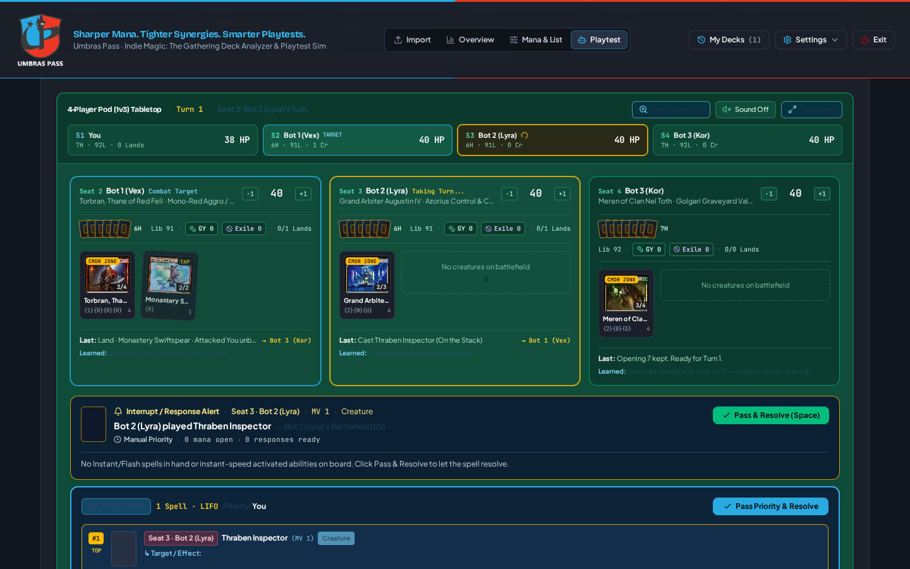

# Bot Playtest & Live Tabletop

The **Bot Playtest** workspace lets you stress-test your deck both statistically (Monte Carlo goldfishing & matchup simulations) and interactively in a **Live Tabletop Simulator**.

---

## Playtest Modes

1. **Automated Simulation (Monte Carlo / Batch):**
   - Runs multi-game opening hand, land-drop, mana-screw/flood, and turn-curve consistency simulations.
   - Correlates draw performance against your mana base (`PlaytestManaCorrelation`) and compares **Original vs. Optimized** deck versions side-by-side.
2. **Live Tabletop Arena (`1v1` & `4-Player Commander Pod 1v3`):**
   - Play turn-by-turn with full manual control against 1 or 3 adaptive AI bot opponents.

---

## Live Tabletop Features

- **Full Turn Phase Progression:** Step through `Untap`, `Upkeep`, `Draw`, `Main`, `Combat`, and `End` phases, with turn summaries and a live match log sidebar.
- **Interactive Zones:** Manage your **Hand**, **Battlefield**, **Library** (with shuffle animation), **Graveyard (`GY`)**, **Exile**, and **Command Zone** via dedicated zone viewers.
- **Stack & Interrupt Response Windows:** Cast instants, flash spells, and activated abilities on the **Stack** and respond during opponent priority / interrupt banners (`TabletopStackPanel`, `InterruptResponseBanner`).
- **Tokens & Counters:** Create custom or standard tokens (`Treasure`, `Food`, `Clue`, `Blood`, creatures) and track `+1/+1`, loyalty, poison/toxic, and player counters.
- **Hover Card Zoom:** Hover any card in hand, on the battlefield, or in zone modals to enlarge it clearly for reading Oracle text.

---

## Adaptive Bot Intelligence & Matchup Memory

- **Bot Difficulty & Personas:** Configure opponent archetypes and difficulty tiers in the Match Setup Lobby.
- **Persistent Matchup Learning:** Bots record threat assessments and card-interaction memories (`botLearning`) across matches so opponents adapt to your deck's win conditions over repeated playtests.
- You can inspect or clear stored bot learning data anytime from the desktop storage / AI settings controls.
