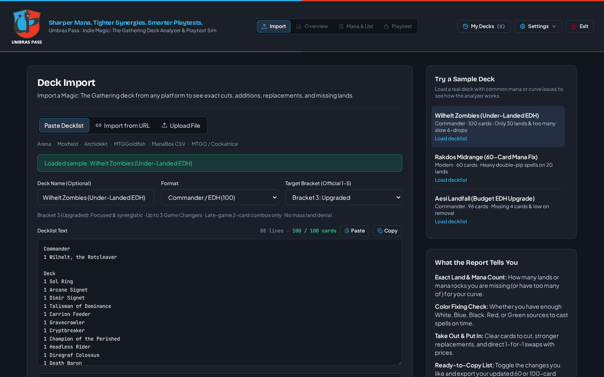

# Deck Importer & Formats

The **Import Deck** tab is the starting point for every analysis and playtest session.

---

## Three Ways to Import a Deck

1. **Paste Decklist:** Paste plain-text exports from MTG Arena, Moxfield, Archidekt, MTGGoldfish, MTGO, Cockatrice, Deckstats, TappedOut, and more. Live client-side parsing immediately summarizes commander(s), mainboard count, sideboard/companion count, and deck-size delta.
2. **Import by URL:** Paste a public deck URL (such as Moxfield, Archidekt, MTGGoldfish, Scryfall, etc.) to fetch and parse cards automatically via the backend importer.
3. **Upload File:** Upload `.txt`, `.csv` (including **ManaBox CSV**), or `.dek` files directly from your computer.

> **Quick Demo:** Use the built-in **Sample Decks** buttons to load curated Commander and 60-card test decks with a single click.

---

## Supported Formats

Select **Auto-Detect** or choose a specific format before running analysis:

| Format | Target Deck Size | Notes |
| --- | --- | --- |
| `Auto-Detect` (`auto`) | Inferred from list | Detects Commander (100-card / Commander zone) vs. 60-card / 40-card lists |
| `Commander / EDH` (`commander`) | 100 (Commander + 99) | Checks singleton rules, color identity, and Commander zone |
| `Brawl` (`brawl`) | 100 / 60 | Checks Commander/Brawl singleton & color identity rules |
| `Standard` (`standard`) | 60+ (+15 sideboard) | Checks Standard legality & 4-of limits |
| `Modern` (`modern`) | 60+ (+15 sideboard) | Checks Modern legality & 4-of limits |
| `Pioneer` (`pioneer`) | 60+ (+15 sideboard) | Checks Pioneer legality & 4-of limits |
| `Pauper` (`pauper`) | 60+ (+15 sideboard) | Checks Pauper legality & 4-of limits |
| `Legacy` (`legacy`) | 60+ (+15 sideboard) | Checks Legacy legality & 4-of limits |
| `Vintage` (`vintage`) | 60+ (+15 sideboard) | Checks Vintage legality / restricted rules |
| `Limited` (`limited`) | 40+ | Draft / Sealed 40-card baseline |
| `Casual 60` (`casual60`) | 60+ | Relaxed legality check for kitchen-table 60-card decks |

---

## Power Goal / Commander Brackets

Choose your target power level (`Bracket 1` through `Bracket 5`) to calibrate land, ramp, interaction, and upgrade recommendations:

- **Bracket 1 (Exhibition / Ultra-Casual):** Theme-first, relaxed curve and mana base expectations.
- **Bracket 2 (Core / Precon Level):** Balanced casual mana consistency and fair interaction ratios.
- **Bracket 3 (Upgraded / High-Power Casual):** Tighter mana curve, reliable turn-1–4 color fixing, and stronger ramp/draw baselines.
- **Bracket 4 (Optimized):** Aggressive land/rock efficiency, low average CMC, and high interaction density.
- **Bracket 5 (cEDH / Competitive):** Maximum mana velocity, fast-mana/tutor-aware benchmarks, and strict early-turn castability targets.

---

## Setting or Changing a Commander

When importing Commander or Brawl lists, Umbras Pass recognizes standard `COMMANDER:` / `// Commander` / `*CMDR*` markers. You can also designate or swap the Commander right from the live deck preview before clicking **Analyze Deck**.
