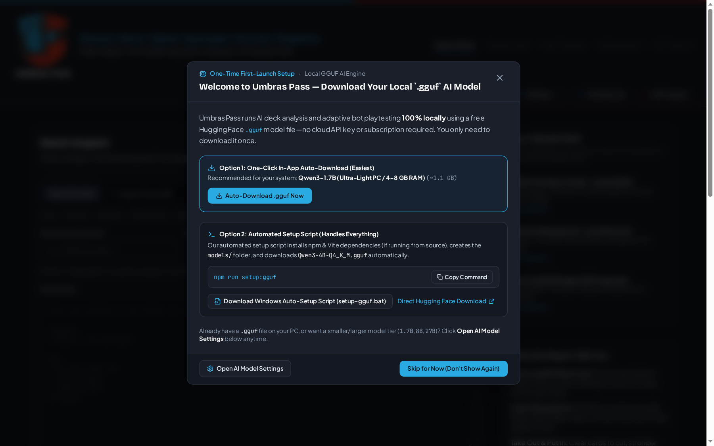

# Getting Started

You can run **Umbras Pass** either as a standalone Windows desktop application (no coding required) or directly from source using Node.js.

---

## Option A: Windows Desktop App (Recommended for Players)

1. Open the **[Releases](https://github.com/bssman89/umbras-pass/releases)** page on GitHub.
2. Download either:
   - **`Umbras-Pass-Setup-<version>.exe`** — Standard Windows installer with Desktop & Start Menu shortcuts and an uninstaller.
   - **`Umbras-Pass-Portable-<version>.exe`** — Self-contained portable executable.
3. Launch **Umbras Pass**.
4. On your first launch, the **One-Click `.gguf` AI Setup** screen appears:
   - Click the download button to automatically fetch the recommended **`Qwen3-4B-Q4_K_M.gguf`** (~2.5 GB) model into your local `models/` folder.
   - Or click skip/close to use the **built-in deterministic rules engine** right away with zero model downloads.



> **Tip:** You can reopen the setup guide anytime from **Settings → General → Welcome & .gguf Setup Guide**.

---

## Option B: Run from Source (Developers & Custom Builds)

### Prerequisites
- **[Node.js v20+](https://nodejs.org/)** (includes `npm`)
- Git (optional, for cloning)

### Automated Setup & Launch

1. **Clone the repository:**
   ```bash
   git clone https://github.com/bssman89/umbras-pass.git
   cd umbras-pass
   ```

2. **Run the automated setup script** (installs dependencies, creates `./models/`, and downloads a `.gguf` model):
   - **Windows:** Double-click `setup-gguf.bat` in the project folder.
   - **macOS / Linux:**
     ```bash
     chmod +x setup-gguf.sh
     ./setup-gguf.sh
     ```
   - **Any OS via npm:**
     ```bash
     npm install
     npm run setup:gguf
     ```

   To choose a specific model size during setup:
   ```bash
   node scripts/setup-umbras-pass.mjs --model=1.7b   # Lightweight (~1.1 GB)
   node scripts/setup-umbras-pass.mjs --model=4b     # Balanced default (~2.5 GB)
   node scripts/setup-umbras-pass.mjs --model=8b     # High-RAM / GPU (~5.0 GB)
   ```

3. **Start the development server:**
   ```bash
   npm run dev
   ```
   Open **`http://localhost:3000`** in your browser, or run `npm run electron` in a second terminal (or standalone) to open the Electron desktop window.

---

## Next Steps

- Learn how to load your first deck in **[Deck Importer & Formats](Deck-Importer-and-Formats)**.
- Explore mana curve diagnostics in **[Mana & Deck Analysis](Mana-and-Deck-Analysis)**.
