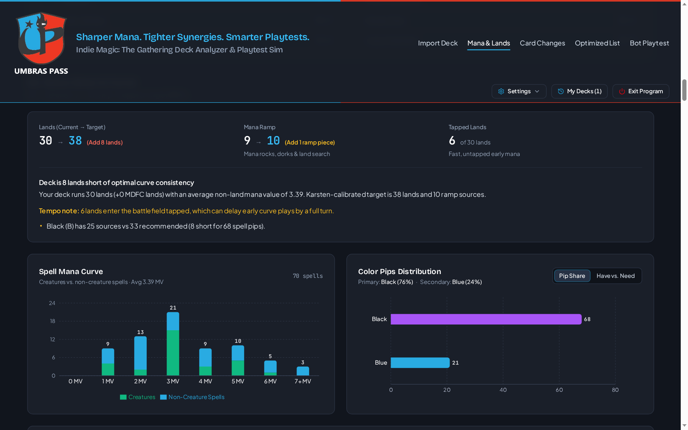

# Welcome to the Umbras Pass Wiki

**Umbras Pass** is an open-source, standalone *Magic: The Gathering* deck analyzer, Karsten-calibrated mana base optimizer, and live tabletop playtest simulator built by **BizRoomba (`bssman89`)**.

It supports **100% private, offline AI** via local `.gguf` language models (`node-llama-cpp`)—with zero cloud API keys or subscriptions required—and automatically falls back to a fast, built-in deterministic rules engine whenever no `.gguf` model is loaded.

---

## Wiki Directory

| Guide | What You'll Learn |
| --- | --- |
| **[Getting Started](Getting-Started)** | Installing the Windows `.exe` or running from source with `setup-gguf` |
| **[Deck Importer & Formats](Deck-Importer-and-Formats)** | Importing from Arena, Moxfield, Archidekt, ManaBox CSV, URLs, formats & Brackets |
| **[Mana & Deck Analysis](Mana-and-Deck-Analysis)** | Land/source math, Turn-T castability, Synergy Audit, Deep Metrics, Hover Zoom & exports |
| **[Bot Playtest & Live Tabletop](Bot-Playtest-and-Live-Tabletop)** | 1v1 and 4-Player Commander pods, Stack interrupts, zones, tokens & adaptive bot memory |
| **[Local AI (.gguf) Setup](Local-AI-GGUF-Setup)** | `Qwen3-1.7B / 4B / 8B` tiers, Hugging Face downloads, manual `models/` setup & CPU/GPU tuning |
| **[Settings & Workspace](Settings-and-Workspace)** | TopBar sections, `My Decks`, local/Firebase profiles, Settings tabs & release updater |
| **[Building from Source & Releases](Building-from-Source-and-Releases)** | `npm` scripts, Electron/NSIS Windows `.exe` packaging, GitHub Actions & publishing this Wiki |
| **[Troubleshooting & FAQ](Troubleshooting-and-FAQ)** | Running without AI weights, low-RAM guidance, SmartScreen, Scryfall & build troubleshooting |
| **[Disclaimer & Credits](Disclaimer-and-Credits)** | Unofficial fan project notice, trademark attributions, "as is" license terms & credits |

---

## Core Capabilities at a Glance

- **Universal Deck Importer:** Paste text, import by URL, or upload `.txt` / `.csv` / `.dek` files from MTG Arena, Moxfield, Archidekt, MTGGoldfish, ManaBox, MTGO, Cockatrice, Deckstats, TappedOut, CubeCobra, MTGTop8, and Pastebin.
- **Karsten-Calibrated Mana & Curve Engine:** Diagnoses land counts, tapped-land tempo, color pip distributions, Turn-T castability odds, ramp/draw/removal/board-wipe counts, and synergy gaps.
- **Interactive Card Previews:** Global hover card zoom overlay across analyzer panels, decklists, and tabletop zones, plus a Card Inspector for alternate printings and marketplace prices.
- **Live Tabletop Simulator:** Playtest turn-by-turn in **1v1** or **4-Player Commander Pod (1v3)** modes with phase progression, stack response windows, tokens/counters, Graveyard/Exile/Command Zone viewers, and adaptive AI bots.
- **Standalone Desktop & Web Modes:** Run as a packaged Windows desktop app (`Umbras-Pass-Setup-*.exe` or Portable `.exe`) or locally in any browser at `http://localhost:3000`.

---

## Quick Links

- **Source Repository:** [github.com/bssman89/umbras-pass](https://github.com/bssman89/umbras-pass)
- **Windows Releases:** [github.com/bssman89/umbras-pass/releases](https://github.com/bssman89/umbras-pass/releases)
- **Issue Tracker:** [github.com/bssman89/umbras-pass/issues](https://github.com/bssman89/umbras-pass/issues)
- **Support Email:** `umbraspass.support@gmail.com`
