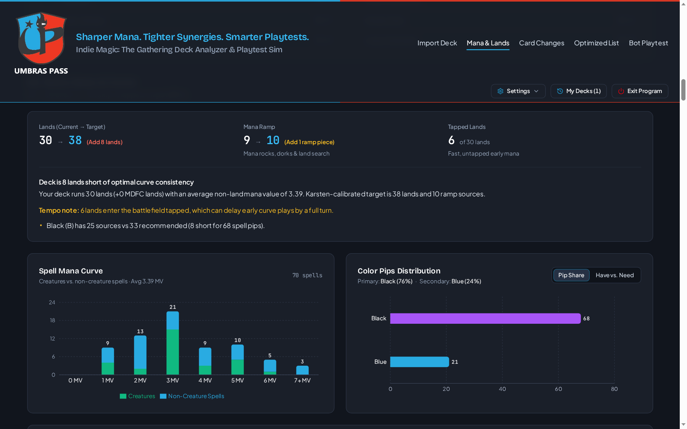
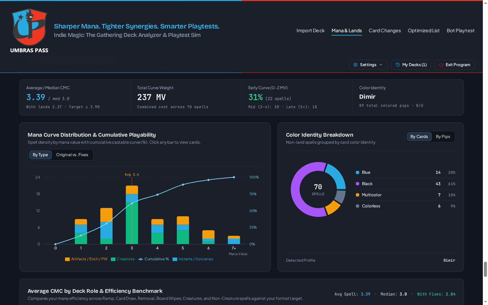

# Mana & Deck Analysis

After importing a deck, Umbras Pass resolves every card through **Scryfall** metadata and runs both mathematical mana/curve calculations and optional local AI / deterministic recommendations.

---

## Deck Overview (`Overview` Tab)

- **Land vs. Spell Gauge:** Compares your current land count (including MDFC lands and tapped-land count) against Karsten-calibrated recommendations for your format, average CMC, and ramp density.
- **Category Targets:** Benchmarks **Ramp**, **Card Draw**, **Targeted Removal**, and **Board Wipes** against target counts for your deck's format and bracket.
- **Format & Rule Audits:** Flags unresolved card names, format-banned cards, singleton violations, and Commander color-identity mismatches.
- **Deck Radar & Budget Comparison:** Visualizes deck strengths across core pillars alongside estimated deck cost across marketplaces.

---

## Mana, Changes & List (`Mana & List` Tab)

### Color Sources & Turn-T Mana Calculator
- **Color Pip vs. Source Breakdown:** Compares colored mana pips in spells against colored sources produced by your lands and mana rocks.
- **Turn-T Castability Checker (`ManaCalculator`):** Uses hypergeometric / color-aware land-pairing simulation (`canSeenLandsPayAtTurn`) to check whether your early-game spells (including `X` spells like `{X}{W}` or multi-pip costs) are reliably castable on curve or **Blocked** by missing color sources or tapped lands.
- **Interactive Tooltips:** Hover any card badge (e.g., `Castable T3` / `Blocked T1`) for turn-by-turn source requirements.

### Advanced Deck Metrics
- Stacked mana curve (Creatures, Artifacts, Enchantments, Instants/Sorceries, Planeswalkers/Other, Lands).
- Cumulative playability odds by turn, color identity breakdown, and average/median CMC benchmarks (with and without lands).

### Synergy Audit & Suggested Card Changes
- **Synergy Audit Panel:** Highlights thematic packages, synergy clusters, and potential dead/off-plan slots.
- **Suggested Cuts, Additions, Swaps & Land Adjustments:** Toggle individual recommendations on or off; your **Optimized Decklist** updates live.

### Card Gallery, Hover Zoom & Inspector
- **Global Hover Card Zoom:** Hover over any card image or card row across the analyzer, mana calculator, gallery, or tabletop to inspect a sharp enlarged preview (can be toggled or positioned cleanly).
- **Card Inspector Modal:** Click a card to inspect Oracle text, alternate printings, set editions, and live marketplace links/prices (**TCGplayer**, **Card Kingdom**, **Cardmarket**, **Cardhoarder**, **eBay**).

### Sharing, Exporting & Version History
- Copy or download your optimized decklist in MTGA / Moxfield / plain-text formats.
- Generate a printable **Deck PDF Report**.
- Save snapshots in **My Decks** (`Version History`) to compare revisions over time.
